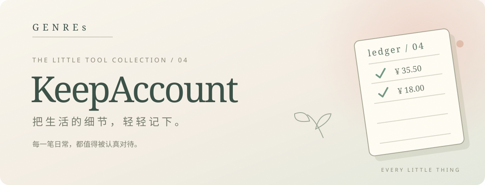
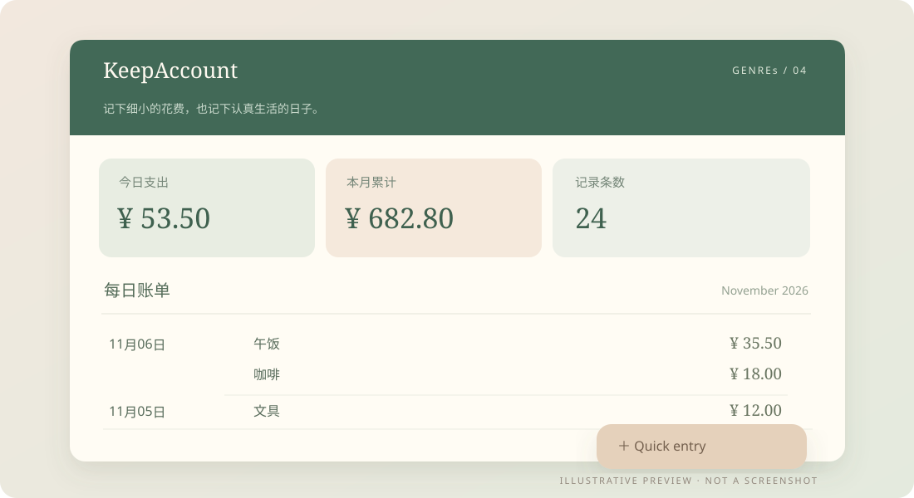

[README.md](https://github.com/user-attachments/files/34538541/README.md)
<p align="center">
  
</p>

<p align="center"><strong>Every little thing counts.</strong><br /><sub>把日常花销，记成生活的细小注脚。</sub></p>

<p align="center"><code>GENREs / 04</code> · Electron · Windows · Local Expense Tracking</p>

**KeepAccount** is a simple, local-first desktop expense tracker. Record a purchase in a moment, then revisit your daily entries and monthly totals whenever you need them.

### ✦ What you can do

| Capture | Look back | Keep it simple |
| :--- | :--- | :--- |
| Record an amount, date, and note | Browse daily entries and day/month spending totals | Add expenses through a floating quick-entry window |

Delete individual entries or use a shorthand such as `35.5 (lunch)` for quick input. Amounts are currently displayed in **Chinese yuan (¥)**.

### ✦ A closer look

<p align="center"></p>

<sub>Illustrative UI concept based on actual features. All amounts and transactions are fictional; this is not an application screenshot.</sub>

### ✦ Get started

Install **Node.js ≥ 22.12** and npm. From the project directory, run:

```bash
npm ci
npm start
```

On Windows, you can also double-click `account.cmd` after running `npm ci`. This is a **source-code release** and does not connect to banks or payment providers.

### ✦ Data & privacy

- Expense records are stored **locally** in Electron's application data directory; there is no cloud sync or bank connection.
- Back up important records yourself. No real receipts or personal spending data are included.
- This is an everyday record-keeping tool, not financial or investment advice.

<details>
<summary><strong>🇨🇳 简体中文 · 中文介绍</strong></summary>

**KeepAccount** 是一款尽量简单的本地桌面记账工具。随手记录花销，想回头看时，能轻松找到那一天的账目。

- **快速记录**：输入金额、日期与备注，也可通过悬浮快捷窗口录入。
- **账目回顾**：查看日／月合计及按日排列的消费记录，支持删除单条账目。
- **简写输入**：例如 `35.5（午饭）`；当前使用人民币 ¥ 显示金额。
- **运行**：安装 Node.js ≥ 22.12，依次执行上方的 `npm ci`、`npm start`；Windows 也可使用 `account.cmd`。
- **隐私**：账目保存在本机，不连接银行卡或云端。请自行备份重要记录。

上方图片为功能示意图，并非程序实际截图。

</details>

<p align="center"><sub>Small moments, neatly kept, by <strong>GENREs</strong> · Little tools, lovingly made.</sub></p>
